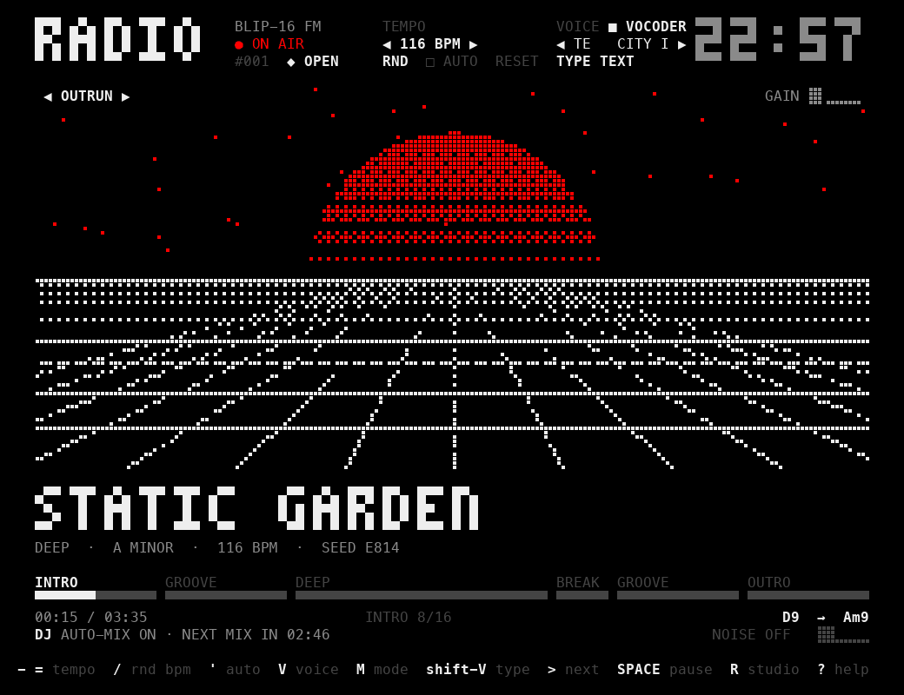
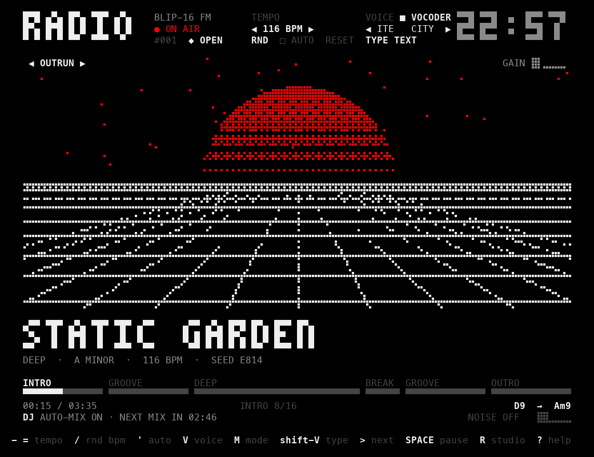
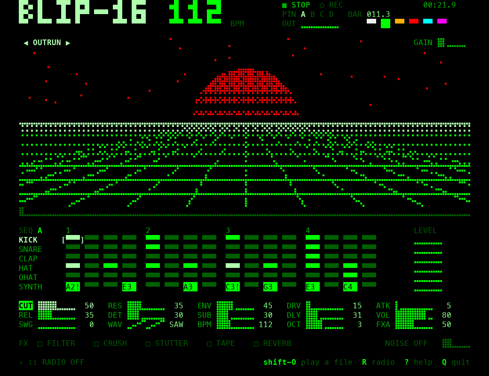
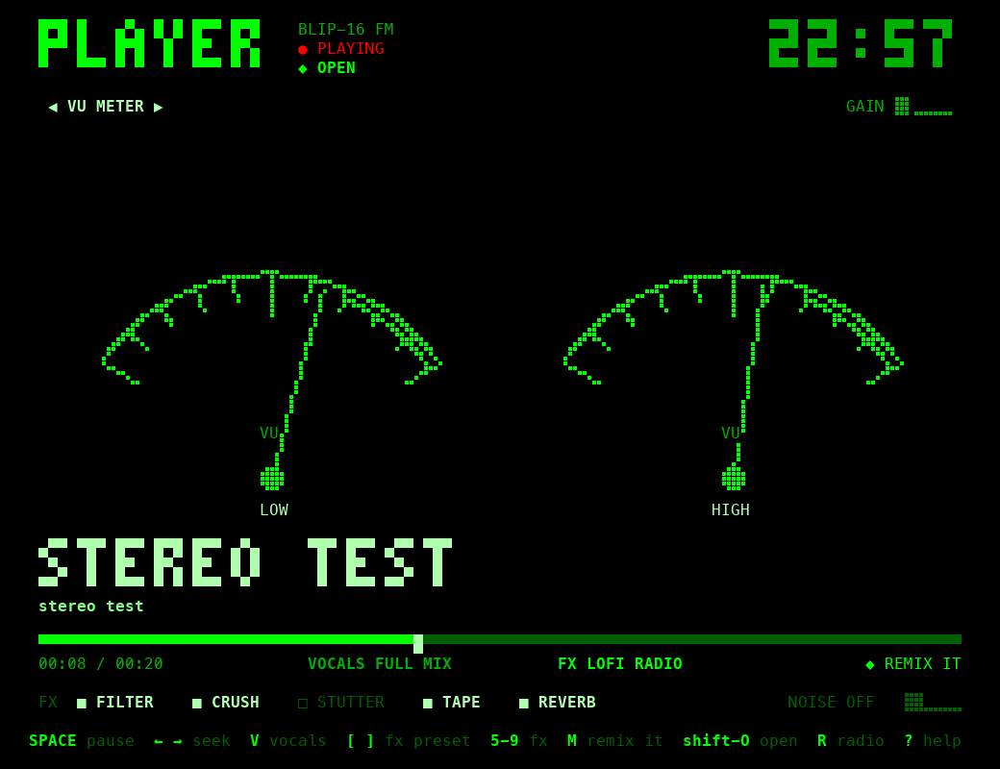
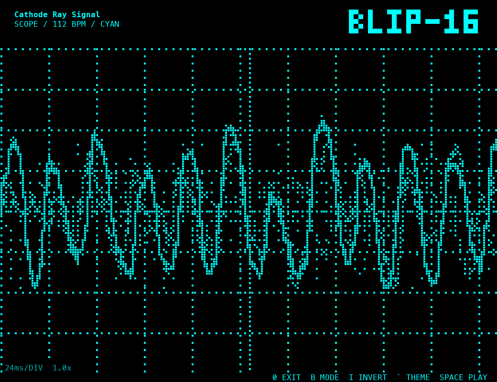

<div align="center">

# BLIP-16

**A pixel-art groovebox, generative radio and music player that lives in your terminal.**

Endless synth / lo-fi / house music written by code in real time, a robot singer, a 16-step sequencer,
80s-style visualizers, and a player that runs any song through retro radio effects.




</div>

---

## Contents

- [Features](#features)
- [Install](#install)
- [Quick start](#quick-start)
- [Screens](#screens)
- [Keyboard reference](#keyboard-reference)
- [Tutorial](docs/TUTORIAL.md)
- [How it works](docs/HOW_IT_WORKS.md)
- [Limitations](#honest-limitations)
- [Development](#development)

## Features

### 📻 Radio: endless generated music
- Every song is **composed live by code**: key, tempo, chord progression, melody, drums, arrangement
  (intro → verse → hook → break → outro) and a song title. Nothing is pre-recorded.
- **7 styles:** `LOFI`, `HOUSE`, `SYNTH`, `CHIP` (8-bit arcade house), `DEEP`, `DREAM`, `FRENCH` (filter disco house).
- Songs last about **2-6 minutes**, with fills, filter sweeps, sidechain pumping, vinyl crackle and tape wow
  that depend on the style.
- **DJ auto-mix:** the next song is picked to match tempo and key, then **beat-matched and crossfaded** in.
  The tempo glides, the fade is equal-power, and kick and bass swap at the halfway point.
- **Tempo control:** nudge, randomise or auto-randomise BPM per song. Your setting survives song changes.
- Every song has a seed. The same seed and style always produce the same song.

### 🎤 Robot voice: sings over the radio
- A **formant singer** built from scratch: resonant vocal tract, breath noise, real consonants
  (fricatives, plosives with aspiration, nasals and liquids that glide), and coarticulation between syllables.
- **4 modes:** `VOCODER` (16-band channel vocoder on a saw carrier), `TALKBOX`, `AUTOTUNE`
  (hard pitch-snap with the stair-step warble) and `SINGER` (natural voice with vibrato).
- **Random lyrics** from an original word bank. Each song gets a recurring hook, an occasional answer line
  and the odd chopped "word word word". You can also **type your own lyrics**.
- **On the beat:** stressed syllables land on the beat, and the *vowel* lands exactly on the grid step.
  The consonant starts just before it, like a real singer.

### 🎛 Studio: a groovebox
- **16-step sequencer** with 6 tracks: kick, snare, clap, hat, open hat and a synth line with per-step notes.
- 4 patterns (A-D), accents, mute/solo, randomise, copy, and **loop recording** from the keyboard piano.
- **Synth:** 4 waveforms, resonant filter with envelope, drive, attack/release, detune, sub oscillator and synced delay.
- **Master FX:** filter, bit-crusher, beat-repeat stutter, tape wobble, reverb.

### 🎧 Player: your own songs through BLIP's effects
- Drag any audio file into the terminal (mp3, m4a, wav, flac...). It plays as-is through the **radio effects**.
- **FX presets:** `LOFI RADIO`, `AM RADIO`, `SPACE`, `UNDERWATER`, `CRUSHED`, `CLEAN`.
- **Vocal separation without AI:** `NO VOCALS` (karaoke) and `VOCALS ONLY`.
- **Remix:** analyses the song (tempo, beat, drum pattern, key, chords, arrangement **and melody**)
  and rebuilds it with BLIP's own instruments.

### 🖥 Look & feel
- Minimal **bitmap** design: a 3×5 pixel font, half-block LED pads and braille-dot meters.
- **6 visualizers in an 80s hardware style:** `LED EQ`, CRT `SCOPE` with phosphor trails, rotating `VECTOR`
  XY display, `OUTRUN` sun and grid, twin analogue `VU METER`s, and Bayer-dithered `DITHER` clouds.
- The visualizer is an **XY pad**: click it to play notes and move the filter. The mouse wheel sets its gain.
- **6 colour themes** (white, green, amber, red, cyan, violet) on a true-black background, plus a fullscreen visual mode.
- **Focus noise:** white, pink, brown or rain.
- Full **mouse** support. Shortcuts also work with a **Persian keyboard layout**, because keys are mapped by position.

## Install

You need **Python 3.9+**, a terminal at least **100×28** with 256 colours, and a font with braille characters.
Menlo, SF Mono, DejaVu Sans Mono, JetBrains Mono and most other modern fonts have them.

```bash
pip install git+https://github.com/boxiboy/BLIP16.git
blip16
```

Or from a clone:

```bash
git clone https://github.com/boxiboy/BLIP16.git
cd BLIP16
python3 -m venv .venv && source .venv/bin/activate
pip install -e .
blip16            # or: python -m blip16
```

**Optional, but recommended:** [ffmpeg](https://ffmpeg.org) to play and remix mp3/m4a/flac files.
Without it, only `.wav` files work.

| OS | Extra steps |
|---|---|
| macOS | `brew install ffmpeg` (optional). `sounddevice` ships its own PortAudio. |
| Linux | `sudo apt install libportaudio2` (plus `ffmpeg` if you want it) |
| Windows | Use WSL. Python's `curses` isn't available in the plain Windows console. |

## Quick start

1. Run `blip16`. The **radio** starts playing straight away.
2. Press **`V`** to let the robot voice sing, and **`M`** to change its style.
3. Press **`B`** to flip through the visualizers, and **`` ` ``** to change the colour theme.
4. Press **`R`** to jump into the **studio** and make a beat. Press **`SPACE`** to start it.
5. Press **`Shift+O`**, drag a song into the terminal and press `Enter` to play it through the effects.
6. Press **`?`** anytime for the full key list.

👉 For a step-by-step guide, see the **[Tutorial](docs/TUTORIAL.md)**.

## Screens

| Radio | Studio |
|---|---|
|  |  |
| **Player** | **Fullscreen visual** |
|  |  |

## Keyboard reference

<details open>
<summary><b>Everywhere</b></summary>

| Key | Action |
|---|---|
| `SPACE` | play / pause |
| `R` | switch radio ↔ studio (from the player: back to the radio) |
| `B` / `Shift+B` | next / previous visualizer |
| `I` / `0` | invert visual / fullscreen visual |
| `` ` `` | colour theme |
| `5`-`9` | master FX: filter, crush, stutter, tape, reverb |
| `Shift+W` / `{` `}` | focus noise type / level |
| `Shift+O` | play a music file (drag it into the terminal) |
| `?` | help |
| `Q` | quit |
| mouse | click pads, knobs, buttons and the progress bar; the wheel adjusts |
</details>

<details>
<summary><b>Radio</b></summary>

| Key | Action |
|---|---|
| `>` | next song (a quick 4-bar DJ mix) |
| `Shift+D` | DJ auto-mix on / off |
| `-` `=` | tempo down / up |
| `/` | random tempo |
| `'` | auto-random tempo for every new song |
| `\` | reset to the song's own tempo |
| `V` | robot voice on / off |
| `M` | voice mode: vocoder, talkbox, autotune, singer |
| `[` `]` | voice lyrics: random lines or a fixed phrase |
| `Shift+V` | type your own lyrics |
</details>

<details>
<summary><b>Studio</b></summary>

| Key | Action |
|---|---|
| arrows / `ENTER` | move the cursor / toggle a step |
| `/` | accent the step |
| `A S D F G H J K L ;` + `W E T Y U O P` | play the synth like a piano |
| `Z` `X` | octave down / up |
| `V` | loop record: what you play is written into the pattern |
| `,` `.` | change the note of a synth step |
| `TAB` / `\` | next pattern / copy the pattern to the next slot |
| `M` / `N` | mute / solo the row |
| `C` / `Shift+R` | clear / randomise the row |
| `[` `]` then `-` `=` | select a synth parameter, then adjust it |
| `1`-`4` | waveform: saw, square, triangle, sine |
| click on the visual | XY pad: x = note, y = filter |
</details>

<details>
<summary><b>Player</b></summary>

| Key | Action |
|---|---|
| `SPACE` | pause |
| `←` `→` | seek ±10 s (or click the progress bar) |
| `V` | vocals: full mix, no vocals, vocals only |
| `[` `]` | FX preset |
| `M` | remix the file in BLIP style |
</details>

## Honest limitations

- **All music is synthesised by code.** It's charming, but it isn't a human producer.
- The **voice** is a formant synthesiser. It speaks English letters only, and its spelling-to-sound rules are simple.
- **Vocal separation** uses stereo placement and steadiness, not AI. It works best on stereo mixes with
  centred vocals. Centred bass and snare are affected a little, and mono files barely separate.
- **Remix analysis** gets tempo and beat right reliably. Key, chords and melody are approximate,
  especially in busy mixes where another instrument sits above the melody.
- Output is **mono**. That suits the radio sound and keeps the engine simple.

> **About other people's music:** the player and remix features work on files *you* provide.
> If you publish a remix of someone else's song, the rights to that song still belong to its owner.

## Development

```bash
pip install -e ".[dev]"
python -m pytest          # 26 tests, ~2 s, no audio device needed
python -m pyflakes blip16 tests
```

```
blip16/
├── constants.py   audio format, tracks, parameters, pixel font, themes, key maps
├── dsp.py         oscillators, state-variable filter, drum samples, dither and noise textures
├── styles.py      scales, instrument presets, the 7 genres, chord names
├── song.py        Pattern and Song (a generated song, written one bar ahead)
├── voice.py       text → syllables, formant singer, vocoder/talkbox/autotune, lyric generator
├── radio.py       song picking, DJ beat-matched mixing, tempo control, voice timing
├── engine.py      real-time audio callback: clock, synth voices, buses, FX, noise
├── analysis.py    tempo/beat/drums/key/chords/melody extraction and remix song builder
├── player.py      file streaming, vocal separation, FX presets
└── ui.py          curses UI: studio, radio, player, visualizers, input
```

Heavy work runs in **separate processes**: the voice renderer, file decoding plus separation, and remix analysis.
So the audio thread never waits on Python's GIL.
The [How it works](docs/HOW_IT_WORKS.md) page explains the DSP and the music generation.

## License

[MIT](LICENSE)
